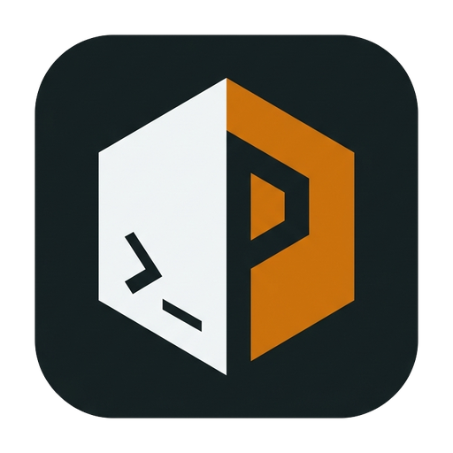

# PyRnustn documentation

{ width="128" height="128" }

`pyrn` accelerates Python and `pytest` suites end to end: pure-Rust symbol-level Test Impact
Analysis (TIA), role-segregated BLAKE3 content-addressed test caching, and an isolated warm-pool
execution engine with container-aware worker sizing and SQLite template cloning.

[Install and run your first suite](getting-started.md){ .md-button .md-button--primary }
[Browse CLI commands](commands.md){ .md-button }

Pure safe Rust (<code>#![forbid(unsafe_code)]</code>) · Zero-dependency Python wheel · Python 3.11+ · Apache-2.0

## New to pyrn?

Evaluating `pyrn` for an existing repository or CI pipeline? [Assess and adopt in CI](ci-adoption.md)
maps common pytest bottlenecks to concrete rollout stages, container safety bounds, and migration
steps from `pytest-xdist` and C-trace coverage.

1. **[Get started](getting-started.md):** build or install the CLI, inspect your host budget with `pyrn doctor`, preview a TIA plan, and start a warm local daemon.
2. **[Choose a recipe](recipes.md):** copy-paste setups for local TDD loops, Django + SQLite suites, GitHub Actions CI, container runners, and `--cov-sysmon`.
3. **[Review benchmarks](benchmarks.md):** inspect verified cold, warm-daemon, SQLite template, and TIA + cache measurements with full parity verification.

## Find the reference you need

| Working on | Read |
| --- | --- |
| CLI subcommands, flags, defaults, and exit codes | [Commands](commands.md) |
| `.pyrn.toml`, `pyproject.toml`, and environment variables | [Configuration](configuration.md) |
| Symbol-level Python AST diffing, `conftest.py` scoping, and confidence tiers | [Test Impact Analysis](tia.md) |
| BLAKE3 closure keys, SQLite WAL storage, and `agent` / `verify` isolation | [Content-addressed cache](caching.md) |
| Persistent `pytest.Session` workers, SQLite template cloning, and crash recovery | [Execution engine](execution-engine.md) |
| Physical-core anti-SMT sizing, Linux cgroups v2/v1, and OOMKill guards | [Resource budgeting](resource-budgeting.md) |
| Bounded `CompactReceipt`, `CrashCapsule`, `--ndjson`, and `--metrics-kv` schemas | [Receipts and telemetry](receipts-and-telemetry.md) |
| Zero-checkout pure-Rust library API (`pyrn-core` with `--no-default-features`) | [Embedding `pyrn-core`](embedding.md) |
| Diagnosing environment, cache, daemon, or Windows path issues | [Troubleshooting](troubleshooting.md) |

## Project information

`pyrn` is beta (`v0.1.0`). See the [benchmarks](benchmarks.md), [changelog](changelog.md),
[security model](security.md), and [contributing guide](contributing.md).
